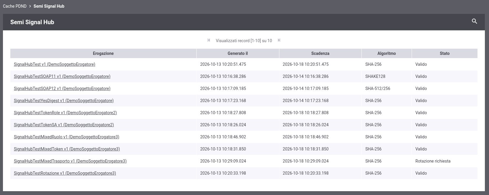
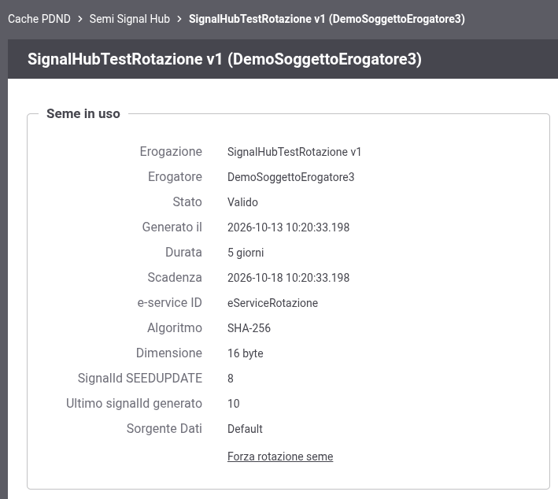
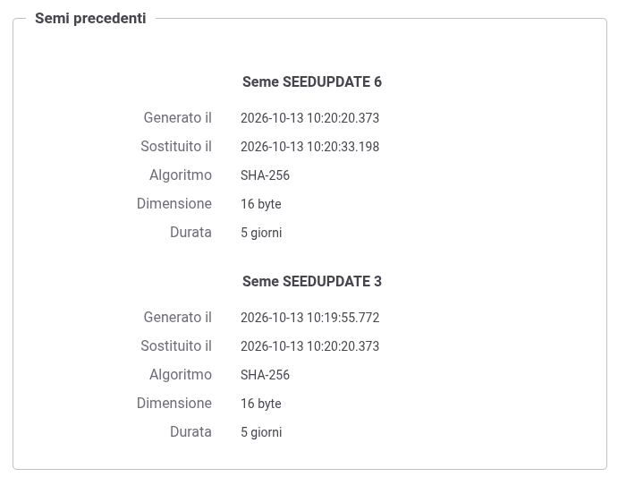
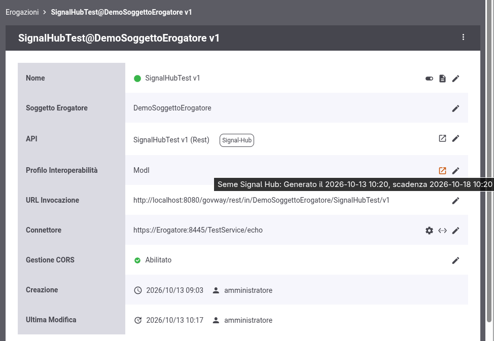
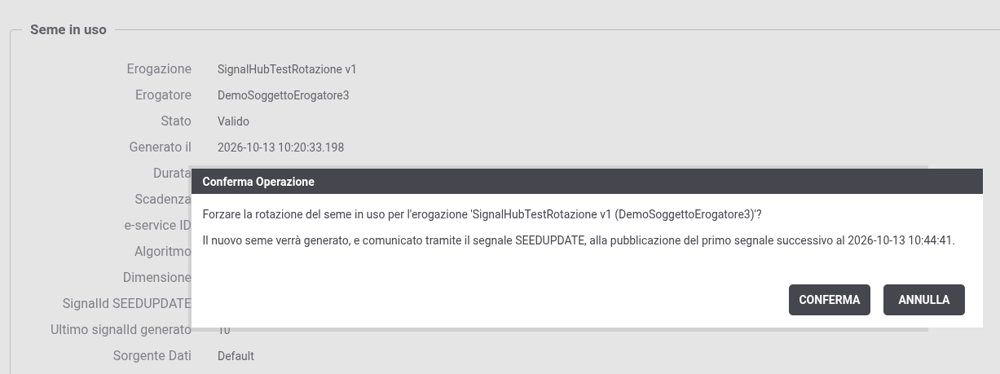

.. _configCachePDNDSemiSignalHub:

Semi Signal Hub
---------------

Selezionando il link '*Semi Signal Hub*' nella sezione '*Configurazione > Cache PDND*' è possibile consultare i semi utilizzati da GovWay per la pseudoanonimizzazione degli identificativi pubblicati nei segnali Signal Hub (:ref:`modipa_signalhub_pseudoanonimizzazione`). Il link è disponibile solamente se il supporto a Signal Hub è abilitato.

L'elenco riporta le erogazioni per cui è stato generato almeno un seme e, per ognuna, le informazioni sul seme in uso (:numref:`cachePDNDSemiSignalHubLista`):

- *Erogazione*: l'erogazione a cui il seme si riferisce;
- *Generato il*: data di generazione del seme;
- *Scadenza*: data di scadenza del seme, calcolata a partire dalla data di generazione e dalla durata impostata sull'erogazione al momento della generazione ('Giorni Rotazione Seme');
- *Algoritmo*: l'algoritmo di hash associato al seme;
- *Stato*: 'Valido', 'Scaduto' se il seme verrà sostituito alla pubblicazione del prossimo segnale, oppure 'Rotazione richiesta' se ne è stata forzata la rotazione; nell'ultimo caso il tooltip riporta la data della richiesta e l'istante dopo il quale il primo segnale pubblicato causerà la sostituzione del seme.

    GovWay Cache PDND: semi Signal Hub

Espandendo la sezione dei filtri di ricerca è possibile ricercare le erogazioni per nome o filtrarle per soggetto erogatore; il filtro sul soggetto non viene proposto se è già stato selezionato un soggetto nella testata della console.

Cliccando sul nome di un'erogazione se ne possono esaminare i dettagli. La sezione *Seme in uso* (:numref:`cachePDNDSemiSignalHubDettaglio`) riporta:

- erogazione, soggetto erogatore e stato del seme; se il seme non è più valido viene indicato quando verrà sostituito e, in caso di rotazione forzata, la data della richiesta;
- data di generazione, durata e scadenza;
- identificativo dell'e-service, algoritmo e dimensione del seme;
- *SignalId SEEDUPDATE*: il signalId del segnale ``SEEDUPDATE`` che ha introdotto il seme (non presente per il primo seme generato);
- *Ultimo signalId generato*: l'ultimo signalId generato per l'e-service, letto dalla base dati runtime di GovWay; consente di valutare quali segnali sono stati pubblicati con il seme in uso. Se sono configurate più sorgenti dati runtime, viene indicata anche la *Sorgente Dati* in cui l'informazione è stata trovata.

    GovWay Cache PDND: dettaglio del seme in uso

La sezione *Semi precedenti* (:numref:`cachePDNDSemiSignalHubSemiPrecedenti`) riporta i semi sostituiti e ancora conservati, nei limiti dello storico configurato tramite la proprietà ``org.openspcoop2.protocol.modipa.signalHub.seed.history`` descritta nella sezione :ref:`modipa_signalhub_properties`; la proprietà indica il numero totale di semi conservati, compreso quello in uso, e la sezione è presente solamente se il valore è maggiore di 1. Ogni seme è identificato dal signalId del segnale ``SEEDUPDATE`` che lo ha introdotto ('*Primo seme*' per il primo seme generato) e ne vengono riportati le date di generazione e di sostituzione, che delimitano il periodo in cui il seme è stato in uso, l'algoritmo, la dimensione e la durata.

    GovWay Cache PDND: semi precedenti

Il valore dei semi non viene mai visualizzato.

Nel riepilogo di un'erogazione, accanto al '*Profilo Interoperabilità*', è inoltre disponibile un'icona il cui tooltip riporta le date di generazione e di scadenza del seme in uso e che apre, in una nuova finestra, il dettaglio descritto in questa sezione (:numref:`cachePDNDSemiSignalHubErogazione`).

    GovWay Cache PDND: seme in uso riportato nel riepilogo dell'erogazione

**Rotazione forzata del seme**

Nel dettaglio di un'erogazione il link '*Forza rotazione seme*' consente di anticipare la rotazione del seme in uso, ad esempio se si sospetta che il seme sia stato compromesso o per applicare subito un algoritmo o una dimensione del seme modificati sull'erogazione, che altrimenti verrebbero applicati solamente alla scadenza. Prima di procedere viene richiesta una conferma, che riporta l'istante dopo il quale il primo segnale pubblicato causerà la sostituzione del seme (:numref:`cachePDNDSemiSignalHubForzaRotazione`); dopo la conferma l'operazione viene registrata nell'audit della console.

    GovWay Cache PDND: conferma della rotazione forzata del seme

Il seme non viene sostituito immediatamente: viene considerato scaduto, in modo coerente su tutti i nodi, trascorso l'intervallo di aggiornamento della cache dei nodi (proprietà ``org.openspcoop2.protocol.modipa.signalHub.seed.cache.refreshSeconds``, per default 5 minuti) e viene sostituito alla pubblicazione del primo segnale successivo, con le modalità descritte nella sezione :ref:`modipa_signalhub_pseudoanonimizzazione_rotazione`. Fino a quel momento il seme continua a essere utilizzato e restituito dalla risorsa di pseudoanonimizzazione.

Dopo la richiesta lo stesso istante viene riportato nel dettaglio del seme.

Il link non è disponibile se la rotazione del seme in uso risulta già richiesta.
