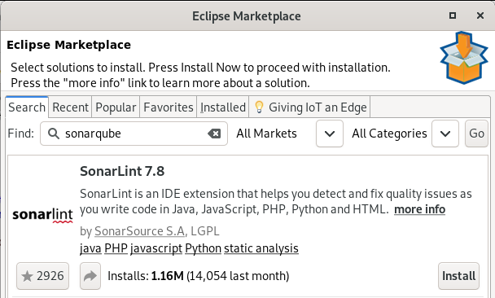
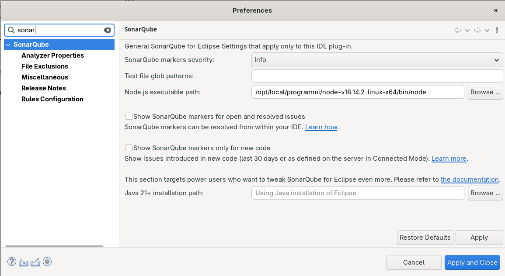
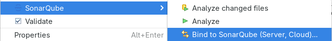
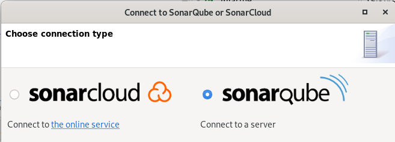
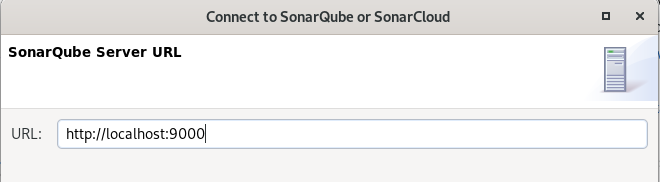
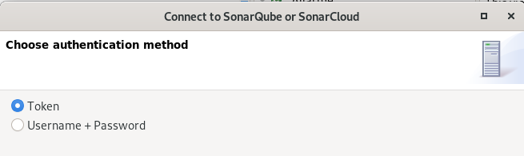
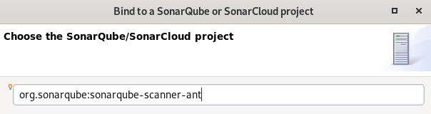
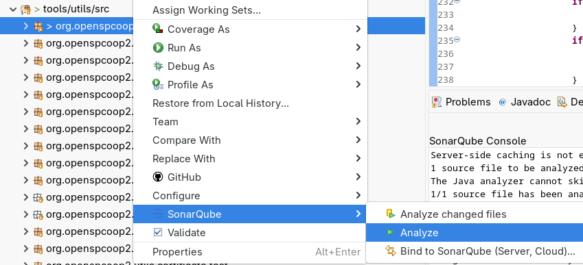
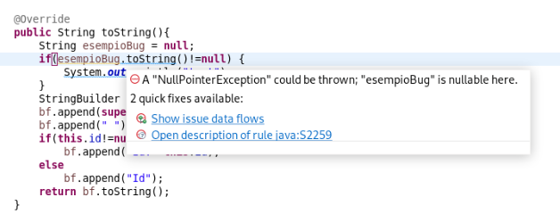

.. _releaseProcessGovWay_staticCodeAnalysis_sonarqube_eclipse:

SonarQube for IDE: Eclipse Plugin
~~~~~~~~~~~~~~~~~~~~~~~~~~~~~~~~~

In questa sezione viene descritto come utilizzare il `plugin 'SonarQube for IDE' per Eclipse <https://www.sonarsource.com/products/sonarqube/ide/features/eclipse/>`_ (precedentemente denominato 'SonarLint') per la verifica del codice sorgente.

Come prerequisito il plugin deve essere stato installato tramite 'Eclipse Marketplace' come mostrato nella figura :numref:`SonarQube_eclipse_markeplace`.

  SonarQube for IDE Eclipse Plugin: marketplace

Per abilitare l'analisi dei sorgenti JavaScript e CSS deve poi essere configurato il tool `nodejs <https://nodejs.org/>`_, in una versione indicata nei `requisiti del plugin <https://docs.sonarsource.com/sonarqube-for-eclipse/getting-started/requirements/>`_, accedendo alla sezione "Window -> Preferences -> SonarQube", come mostrato nella figura :numref:`SonarQube_eclipse_config`:

  SonarQube for IDE Eclipse Plugin: configurazione nodejs

Il progetto di Eclipse contenente i sorgenti soggetti a controllo della qualità (:ref:`releaseProcessGovWay_staticCodeAnalysis_src_eclipse`) deve essere legato a SonarQube effettuando il bind tramite la voce 'SonarQube -> Bind to SonarQube (Server, Cloud)...' come mostrato nella figure :numref:`SonarQube_eclipse_config_bind`, :numref:`SonarQube_eclipse_config_bind_type`, :numref:`SonarQube_eclipse_config_bind_url`, :numref:`SonarQube_eclipse_config_bind_auth`, :numref:`SonarQube_eclipse_config_bind_project`.

  SonarQube for IDE Eclipse Plugin: avvio fase di binding

  SonarQube for IDE Eclipse Plugin: binding verso SonarQube

  SonarQube for IDE Eclipse Plugin: binding url

  SonarQube for IDE Eclipse Plugin: binding authentication type

  SonarQube for IDE Eclipse Plugin: binding project 'govway'

L'analisi statica dei sorgenti è adesso effettuabile selezionando con il tasto destro il progetto 'op2_3.x.dev' (:ref:`releaseProcessGovWay_staticCodeAnalysis_src_eclipse`), o una sua parte (es. una directory di sorgenti o un package), e cliccando sulla voce 'SonarQube -> Analyze' come mostrato nella figura :numref:`SonarQube_eclipse_find`. La voce 'SonarQube -> Analyze changed files' consente invece di analizzare i soli file modificati.

  SonarQube for IDE Eclipse Plugin: analyze

Eventuali bug individuati vengono evidenziati sulla singola classe come ad esempio viene mostrato nella figura :numref:`SonarQube_eclipse_bug`.

  SonarQube for IDE Eclipse Plugin: esempio di bug
